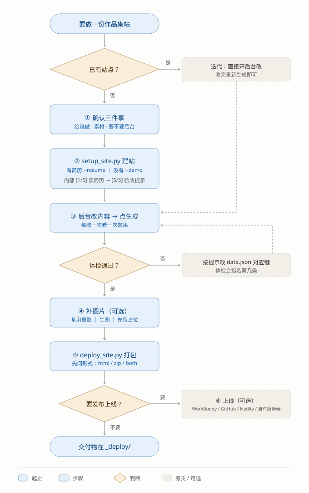

# 寻踪作品集网站自动搭建

> 批量生成「液态玻璃」个人作品集 / 简历站的建站工具。
>
> **作者：寻踪踏迹** ｜ **正式版 1.0** —— 2026-11-04。
> 由一套实际在用的个人作品集工程提炼而来，已参数化、去个人化：
> 模板里不含任何真实姓名、单位、联系方式或账号。
>
> **用户是第一次用 → 先读「第一次调用：先把教程发出去」**，别开口就甩命令。
> **内置 Demo 可直接打开**：`examples/demo-site/portfolio/index.html`
> （人物「陈屿」为**纯虚构**，学校、电话、邮箱、链接全是占位信息。）

## 这套东西是什么

三个角色，一个真源：

```
portfolio/data.json   ← 唯一真源（内容全在这里）
        │
        ├─ build/gen_site.py + build/site.css ──→ portfolio/index.html
        │      （纯 Python 拼字符串，读同目录样式表内联进 <style>，无框架无构建）
        ├─ build/validate_data.py  ──→ 生成前体检 data.json 的形状
        └─ admin/server.py         ──→ 本地后台，直接读写 data.json + 一键重生成
```

- **没有 npm / 没有框架 / 没有构建工具**。产物是**单文件 HTML**，图片走相对路径，可离线分发。
- 视觉是**液态玻璃**（毛玻璃 + 折射描边 + 彩色渐变底），样式全在 `build/site.css`。
- 后台是**标准库 `http.server`** + 原生 JS，双击启动脚本（Windows `.bat` / macOS `.command`）或由脚本拉起。
- 依赖只有 **Pillow**（缩略图 / 图片压缩 / 摄影墙宽高比）。没装也能跑，这几项退化。

## 现在有什么

| 能力 | 一句话 | 细节 |
|---|---|---|
| 页面 / 板块两层 | 一页 = 网页一屏 + 导航一项；板块决定这一屏放什么内容 | `references/data-schema.md` |
| 导航常驻 + 横滑 | 导航项永远在顶栏，放不下就整排横滑；窄屏品牌名先省略、≤560 只留 logo | `design-system.md` |
| 11 种页面模板 | 新建页面时先选类型（带版式缩略图），上限 10 页，删页不删内容 | 本文「页面设置」 |
| 四类文字内容 | 论文、随笔、方案、设计物料，各有大封面 / 时间线 / 分组网格版式；设计物料的分组用表单编辑（加组/加图/排序/选图/版式下拉） | `data-schema.md` |
| 论文内页导入 | 后台传 **PDF**（推荐，原样保真）或 Word，自动抽前 4 页转成内页图，第 1 页顺带当封面 | 本文「论文内页从文件导入」 |
| 深浅色四模式 | 跟随系统 / 恒定浅 / 恒定深 / 按时间（默认 19:00→07:00） | `design-system.md` |
| 图片灯箱 | 摄影、作品、奖项、论文封面与内页、设计物料都能点开；论文内页可缩放 | 本文「图片放大」 |
| 数据体检 | 生成前把形状过一遍，报「哪个键、第几条、该长什么样」 | `build/validate_data.py` |
| 历史版本 | 每次保存留一份快照（最多 30 份），后台一键回滚 | 本文「历史版本」 |
| 素材读取省消耗 | 只读图片 / 文档 / 设计物料；视频只取首帧或同目录封面，不碰视频内容 | 本文「素材读取规则」 |
| 网页爬取素材 | 旧主页 / 社媒的作品名、数据、图片用 web-access 抓，文字重写、专名保留 | `references/web-crawl-guide.md` |

## 先看 Demo（判断要不要用）

```bash
python scripts/preview.py --site examples/demo-site
```

Demo 的规模（全部虚构，用来判断真实体量下版式是否成立）：

| 区块 | 内容 |
|---|---|
| 首屏 | 站名 / 中英文名 / 一句话介绍 / 4 个数字 / 3 行小字 |
| 影像作品 | 5 个分组、19 张卡（专项大卡 · 人文纪录 5 · 系列栏目 4 · 竖屏 3 · 实验 4） |
| 摄影 | 6 个分类、30 张，按真实宽高比铺满整行 |
| 图文 | 2 个分组、6 个项目（技术栈 / 指标 / 截图） |
| 论文 | 2 篇（大封面 + 内页条） |
| 随笔 | 3 篇（时间线，一行一条） |
| 设计物料 | 2 套（分组网格 + 通栏大图；第二套带一张「印刷规格」清单卡，用来看分组编辑器长什么样） |
| 关于我 | 侧栏 8 条事实 + 3 个内容块 |
| 奖项 | 5 条，挂在对应作品卡右下角 |

## 什么时候用它

- 用户要做**个人作品集 / 简历站**（影像、摄影、设计、内容运营这类「以作品为主」的）。
- 用户要**批量**做：给同学、队友、客户各做一份。
- 用户已经在用这套模板，要**改内容 / 加页面 / 重新发布**。

## 第一次调用：先把教程发出去

**对方是新手，就先讲话、再动手。** 判据三条，中任意一条就算新手：

- 他说的是「这怎么用」「我能做什么」，而不是具体字段或文件名；
- 三件事（给谁做 / 有什么素材 / 要不要后台）一个都还没说；
- 他的素材是「一堆照片 + 一份简历」，没有结构。

**那就把 `references/beginner-guide.md` 的「三十秒版」整段发出去**，原样发，
不要改写成命令清单、不要附 `data.json`、不要先讲目录结构。

- 他接着问 → 按那份文件往后展开：先看样例站 / 三个问题 / 六步分工表 / 后台三条规矩 / 卡住的六件事 / 最后拿到什么。
- 他已经在说「用我的简历建，输出到 D 盘」→ **跳过教程**，直接进 ①。

> **两份东西别混。** `references/beginner-guide.md` 是给人看的：没有命令、没有键名、
> 只有「你要做什么」。下节「标准流程」是给 agent 看的：命令、判据、失败回退。
> 把流程里的词发给用户，他只会多问一轮「`--resume` 我要在哪敲」。

## 标准流程



**两套编号，先分清，混了会乱：**

| | 是什么 | 范围 |
|---|---|---|
| **① — ⑥**（本节） | **工作流**：你跟用户从头走到尾的六个阶段 | 从「要做什么」到「东西在哪」 |
| **`[1/5]` — `[5/5]`** | **`setup_site.py` 内部的五步** | 只覆盖 ② 这一段 |

> 看到脚本打印 `[3/5] 首次生成网页`，**不代表流程走了一半**——它还在 ② 里面。
> 工作流的 ③④⑤ 脚本一个字都不会提，得你自己接着走。

### 入口分流（动手前先判断一句）

| 用户的情况 | 从哪进 | 不要做的事 |
|---|---|---|
| 从零做一个 | ① | 别跳 ① 直接甩命令，字段猜错了要返工 |
| 已有站点，改内容 | ③ | 别重跑 `setup_site.py`，会覆盖 |
| 只换配色 | ③ 总设置 → 网站配色 | 不用碰 `data.json` |
| 换了电脑 / 后台崩了 | ② 只跑 `open_admin.py` | 别重建站 |
| **在 agent / 托管会话里起后台** | **`open_admin.py --foreground`**，由 agent 以前台后台任务持有 | **别走默认 detach 路线** —— 父命令一结束，服务就被运行环境回收 |
| 只要重新发布 | ⑤ | 不用先跑生成，`deploy_site.py` 会同步 |

### 素材读取规则（动素材前先看，省时间省消耗）

用户给一个素材目录时，**只读这个目录里建站用得上的东西**，别的不碰：

| 类型 | 怎么处理 |
|---|---|
| 图片（jpg / png / webp…） | 正常读：压图、生成缩略图、按内容归类进 `assets/` |
| 文档（docx / pdf / txt / md / json） | 正常读：简历、论文走对应导入，文本当内容素材 |
| 设计物料（海报 / 门票 / 展签的图） | 正常读：进设计物料分组 |
| **视频（mp4 / mov / avi / mkv…）** | **默认不读内容**，只配一张封面：① 优先同目录同名封面图（`video.mp4` → `video.jpg` / `cover.jpg`）→ ② 本机有 ffmpeg 才抽首帧（`ffmpeg -i 视频 -frames:v 1 -q:v 2 封面.jpg`）→ ③ 都没有就留占位图并明说。视频本身只当「有这件作品」的条目（路径 / 链接进 `data.json`），**不转码、不上传、不喂给任何生成或理解流程** |

- **为什么**：视频又大又贵 —— 解码 / 上传 / 理解都费时费信用点，而作品集要的是**封面 + 一条视频链接**，
  不是视频内容本身。**除非用户明确要**（「视频页要放真视频」「帮我从视频里截几张图」）才做更多，
  且先报代价、经同意再动手。
- 目录里的其它东西（压缩包、工程文件、可执行文件……）**不读不碰**；递归只看用户指的那个目录，
  别往外扫。

### ① 确认三件事

问清楚，不要替用户假设（怎么问、为什么这么问，见 `beginner-guide.md`「你只需要回答三个问题」）：

1. **给谁做** —— 决定 `site.brand` / `hero` / `about.facts`。
2. **有没有现成素材** —— 作品图、简历、奖项。有就一次填完；没有就先用占位图跑通版式。
3. **要不要后台** —— 本人以后要自己改就要；一次性的直接改 `data.json` 也行。

顺带问一句**有没有旧主页**。有就推荐用 **web-access** skill 联网抓素材（旧主页、微博 / 小红书 /
GitHub / 豆瓣等的作品名、数据、图片 —— 一步步教程见 `references/web-crawl-guide.md`）；
静态单页也可以跑 `fetch_refs.py --url <地址> --download`，
把标题 / 简介 / 小标题 / 主视觉 / 主色抓成 `refs.json`——**只是素材，文字必须重写**。

- **完成判据**：上面三问都有明确答案，且知道有没有参考网址。
- **别做**：还没答完就开始建站；把 `refs.json` 里的原文直接贴进站点。

### ② 建站（`setup_site.py`）

| 手上有什么 | 命令 | 建出来是什么 |
|---|---|---|
| 简历（docx/pdf/txt/md/json） | `setup_site.py --out <目录> --resume 简历.docx` | 抽得到的字段填上，抽不到的**留空不编** |
| 什么都没有，想先看版式 | `setup_site.py --out <目录> --demo` | 虚构人物「陈屿」的完整站 |
| 什么都没有，直接手填 | `setup_site.py --out <目录>` | 空白骨架 + 占位图 |

脚本内部五步：`[1/5]` 读简历 → `[2/5]` 建目录 → `[3/5]` 首次生成 → `[4/5]` 起后台 → `[5/5]` 验收提示。

- **完成判据**（三条都要满足）：
  1. `<目录>/portfolio/index.html` 存在，双击能打开；
  2. 后台在跑（终端里有一行 `http://127.0.0.1:88xx`）；
  3. 浏览器已经打开到后台总设置页。
- **失败怎么办**：
  - 目录非空 → 加 `--force`（**先确认里面没有用户的东西**）；
  - 后台没起来 → 退出码不影响站点本身，双击 `<目录>/admin/start-admin.bat`
    （macOS 是 `start-admin.command`），或 `open_admin.py --site <目录> --port 8900` 换个端口；
  - **在 agent / 托管会话里，默认启动方式一定失败**：脚本报「后台已启动」、`/api/health`
    也通过，但命令一结束进程就没了（`tasklist` 查不到、日志 0 字节、页面打不开）。
    这不是 bug，是父进程退出时沙箱级联回收子进程。改用
    `open_admin.py --site <目录> --foreground`（或直接前台跑 `admin/server.py`），
    由 agent 以托管后台任务持有。被外部终止时退出码是 **1073807364**（`0x40010004`，
    即 `DBG_TERMINATE_PROCESS`），看到这个码就是「被运行环境回收」，不是代码错；
  - 生成报错 → 看 `[3/5]` 那几行，通常是数据体检没过，按提示改 `data.json`。

### ③ 内容校准（后台为主）

用户在后台改，改完点「生成网页」，刷新预览看效果。**这一步是循环，不是一次**。

- 改什么：站名 / 首页文案 / 作品卡 / 摄影图 / 论文 / 关于我 / 配色。
- **第一次生成**（`portfolio/index.html` 还不存在那次）：后台会**直接用浏览器把网站打开**，
  并在站点根目录放两个双击启动文件 `打开网站.bat`（直接看站，不需要后台）和
  `打开后台.bat`（回来改内容）；macOS 上对应生成 `.command` 版本。之后每次生成只安静地重跑，
  不再弹浏览器 —— 这是用户的明确要求：生成完得能立刻看见东西，不能只留一句「已生成」。
- 不需要后台也能改：直接编辑 `portfolio/data.json`，再跑 `build.py --site <目录> --check`。
- **完成判据**：用户说「就这样」，且 `build.py --check` 打出 `体检通过：引用资源一个不缺`。
- **失败怎么办**：体检没过会指名「哪个键、第几条」，改完再生成；改坏了用后台「历史版本」回滚。

### ④ 补图片（可选，但最容易被跳过）

占位图长得像真的，扫一眼看不出来。判据很简单：**文件小于 45KB 的基本都是占位**（真照片压到 1280 宽也不会这么小）。

```
python -c "import pathlib;[print(f, round(f.stat().st_size/1024)) for f in pathlib.Path('<目录>/portfolio/assets').rglob('*.jpg') if f.stat().st_size < 45000]"
```

按这个顺序补，**能复用就别生图**：

1. **复用已有摄影成品换框**（零成本）——同一批拍摄的另一张，构图一换就成立；
2. **生图**——只有素材库里真的没有这个画面时才用（生图 5–10 信用点一张，先报数量）；
3. **留占位**——明确告诉用户「这几处还是占位图」，别默认他看得见。

- **完成判据**：把上面那条命令再跑一遍，剩下的每一张你都跟用户交代过。
- **注意**：换框复用时冲突不在文件名，在**派生链**（`still_04 ← city_07` 这种），
  见 `pitfalls.md` #62 一带。

**导入的图片一律走统一命名，原文件名不参与**（v1.22.0）：

| 来源 | 落成的名字 | 说明 |
|---|---|---|
| 后台上传（封面 / 奖项 / 项目 / 设计 / 自媒体） | `cover-20261104-01.jpg`、`design-20261104-02.png` | `<目录短名>-<日期>-<两位序号>`，序号按天递增，永不覆盖 |
| 论文 / 文档导入内页 | `papers-20261104-01_p1.jpg` | `<目录名>-<日期>-<序号>_p<页号>`，重导得到 `-02`，旧内页仍可用 |
| 摄影墙 | `航拍_01.jpg`（分类 key + 两位序号） | 生成器按名字分组，**不能改** |

- 为什么不要原名：手机/微信导出来的是「图片(30).jpg」「微信图片_20260421…jpg」，看不出内容；
  括号进 URL 要转义（v1.21.1 单文件裂图就是这么来的）、中文名经 zip 分发容易乱码（pitfalls 71）。
- 例外（必须固定名）：`hero/cover.jpg`、`hero/avatar.jpg`、`about/portrait.jpg`、数码头像
  `assets/digital/avatar.jpg`、logo —— 它们靠**同名覆盖**来换图。

### ⑤ 打包交付（一定要问形式）

| 用户想要 | 命令 | 给什么 |
|---|---|---|
| 只想看 / 发给别人 | `--pack html` | 单个 HTML，图片全内联，双击就开 |
| 要部署 / 以后自己改 | `--pack zip` | 压缩包，可解压可上传 |
| 说不清 | `--pack both` | 两个都出 |

```
python scripts/deploy_site.py --site <目录> --pack ask
```

- 脚本会先同步发布副本 + 全量体检，**体检不过就不打包**。
- 在后台里也能做：点「生成网页」→ 弹窗「存为单文件 / 下载压缩包」。
- **完成判据**：`<目录>/_deploy/` 里有产物，且**你亲手打开过一次**（单文件尤其要试，
  图片没内联成功在编辑器里看不出来）。
- ⚠️ 打包 ≠ 上线。到 `--push` 之前，域名和仓库都没动。

### ⑥ 上线（可选）

五条路，按用户的情况选：

| 路线 | 适合 | 怎么走 |
|---|---|---|
| WorkBuddy 网页端 | 人在 WorkBuddy 里做站，最省事 | 对话说「发布上线」→ 用「发布为应用」把站点挂成在线链接，托管与 HTTPS 平台管，**全程不离开对话** |
| GitHub 网页版 | 没装 git、不想敲命令 | 全程浏览器，四步（见下） |
| GitHub Pages（git） | 想要固定网址、以后接着改 | `deploy_site.py --github` 备好可 push 的 `gh-pages` 目录 |
| Netlify Drop | 最快，不想注册一整套 | 把 `zip` 或 `_publish_tmp` 拖进 app.netlify.com/drop |
| 自有服务器 | 已经有域名和主机 | `_publish_tmp` 全量覆盖上去，纯静态 |

**GitHub 网页版（全程浏览器，不装 git）**：

```
[手动] ① https://github.com/new 建空仓库（不勾 README）
[手动] ② Add file → Upload files，把 gh-pages/ 整个文件夹拖进上传区（.nojekyll 不能漏）
[手动] ③ Settings → Pages → Source: Deploy from a branch，main / (root) → Save
[等待] ④ 约 1 分钟 → https://<用户名>.github.io/<仓库名>/
[手动] ⑤ 绑自定义域名（可选，见 references/custom-domain.md）
```

**GitHub Pages（git 命令）**：`deploy_site.py` 结尾会原样打印下面这段，**照这个跟用户说**（已经标了谁来做）：

```
[自动] ① 生成 gh-pages 目录 + 写 .nojekyll
[手动] ② 在 github.com/new 建一个空仓库（不勾 README）
[自动] ③ git init / add / commit
[自动] ④ git remote add origin <地址> —— 用户把地址给我，我来加
[自动] ⑤ git push -u origin main —— 首次推公开仓库要用户的 GitHub 授权
[手动] ⑥ 仓库 Settings → Pages → Source: Deploy from a branch，main / (root)
[等待] ⑦ 约 1 分钟 → https://<用户名>.github.io/<仓库名>/
[手动] ⑧ 绑自定义域名（可选，见 references/custom-domain.md）
```

- 网页版全程只能用户点；git 版只有 ②⑥⑧ 只能用户做，其余能代劳。
- **想用自己的域名**（`www.你自己的名字.com`）：照 `references/custom-domain.md` 带用户
  一步步走（Cloudflare + GitHub Pages，域名成本之外零费用）。
- ⚠️ 打包/出发布物 ≠ 上线。到 `--push` 之前，域名和仓库都没动。

## 后台：怎么启动、有哪几页

四个入口，做的事一样（都是起 `admin/server.py`），差别只在**进程由谁持有**：

| 入口 | 谁用 | 进程模型 |
|---|---|---|
| `setup_site.py` 的 [5/5] | 建站流程 | detach，起不来不影响站点本身 |
| `scripts/open_admin.py` | 人坐在电脑前 | detach 到新控制台，脚本立刻返回；`--stop` 收工 |
| `scripts/open_admin.py --foreground` | **agent / 托管会话** | 不脱离，脚本自身阻塞到被停；由调用方持有 |
| `admin/start-admin.bat`（Windows）/ `start-admin.command`（macOS） | 用户双击 | bat 是纯 ASCII 内容 **+ 纯 ASCII 文件名**（cmd 按 OEM 码页解析，中文注释会被当命令；中文名经 zip 分发会乱码）。**中文提示一个字都不许写在 bat 里**，全部由 `server.py` 打印 —— Windows 上 Python 走 `WriteConsoleW`，不受控制台码页影响；`chcp 65001` 也救不了（见 pitfalls 71）。mac 的 `.command` 双击开终端跑，同样不写中文；zip 解压会丢执行位，双击没反应时 `sh 文件名` 照样能跑 |

> **选错会怎样**：在 agent 环境里用默认 detach，服务会**静默死亡** ——
> 报「后台已启动」、`/api/health` 也通，但父命令一结束进程就没了，日志 0 字节，
> 用户只看到「网页打不开」。判断依据见 ②「失败怎么办」的 `0x40010004`。

三条实现细节（改这块别退回去，详见 `references/pitfalls.md` 34–38）：
日志名带端口（`server-8848.log`）｜探活用 `/api/health` 不走 `/api/ping`｜
`ConnectionAbortedError` 不算错。

### 总设置页

| 卡片 | 能改什么 | 落在哪 |
|---|---|---|
| 站点信息 | 站名、英文名、本人姓名、网页标题、SEO 描述 | `site.brand / brand_en / owner / title / desc` |
| 标识与图标 | 顶栏 logo（png 保留透明）、首屏大头像、收藏夹图标（由头像重做 5 个尺寸） | `site.logo`、`site.avatar`、`portfolio/favicon*` |
| 导航与页脚 | 右上 CTA 文案、页脚那行 | `navcta`、`footer` |
| 网站配色 | 默认深浅色四档 + 两个时间点 | `site.theme.mode / darkAt / lightAt` |
| 主题配色 | 6 套预设（海蓝/暖橙/朱砂/松绿/鸢尾/雾青）+ 自定义取色，带浅深双预览 | `site.theme.accent` |
| 历史版本 | 列出 `_bak/data-*.json`，一键回滚（回滚前再备份当前版） | `portfolio/_bak/` |

### 页面设置：页面 → 板块两层

**一个页面 = 网页上一屏 + 导航一项。** 内容仍住在 `data.json` 顶层键里，页面只记
「谁放在哪、叫什么名、显不显示」—— 所以**删页面不删内容**，撤下来再建回去一条不少。

| 操作 | 在哪 | 结果 |
|---|---|---|
| 调顺序 | 卡片上的 ↑ ↓ | 网页分区顺序 + 导航顺序一起变 |
| 隐藏 | 「显示」开关 | 不上网页、不进导航，内容留着 |
| 删除 | 卡片上的 ✕ | 弹窗二次确认，默认只撤下；连内容删要先勾「我确定」 |
| 加板块 | 卡片上的「编辑」 | 一页可挂多块（多块时自动多一屏「页面大标题 + 简介」） |
| 新建页面 | 三处入口共用同一个弹窗 | **先选模板再起名** |

11 张模板卡分三组，每张带版式缩略图 + 一句实话（这类内容备好了几条）：

| 组 | 模板 → 板块 |
|---|---|
| 作品展示 | 视频页 `work` · 摄影页 `photo` · 设计与物料页 `design` · 图文页 `projects` · 数码页 `digital` |
| 文字内容 | 文档展示页 `papers` · 随笔页 `opeds` · 方案页 `proposals` |
| 个人与其他 | 关于我页 `about` · 联系页 `contact` · 空白页（无板块） |

三条不能忘：

1. **一种内容只能挂在一页上**；已在别页时会**整块挪过来**，原页空了自动收起。
2. **不可选的卡要写清原因**（「这类还没有内容」「这类不在后台改」），别只置灰。
3. **上限 10 页**（`PAGE_MAX`），满了直接 toast，不弹窗。

弹窗是「头 / 正文 / 按钮」三段式，三个 flex 属性一个都不能省（省了会裁掉按钮或压扁标题）：
`flex:none` / `flex:1 1 auto;min-height:0;overflow-y:auto` / `flex:none`。
宽弹窗用 `#mdMask.wide` 切类名，**别在标签上写内联 width**。详见 `pitfalls.md` 40–41。

### 后台里写什么说明、不写什么

用户要的是「给操作这个后台的人」看的说明，不是「给网站设计者」看的：

| 留（用户视角） | 删（设计者视角） |
|---|---|
| 「改完点右上角『生成网页』，网页才会变」 | 「生成器按 `site.pages` 顺序渲染」 |
| 「取消勾选＝先藏起来，内容还在」 | 「`show:false` 的块不进导航、不占序号」 |
| 「留空就不显示这个按钮」 | 「空串会落回 `DEFAULT_CTA`」 |

**判据：说的是「你能做什么、点了会怎样」→ 留；说的是「系统内部怎么实现」→ 删。**

### 历史版本（回滚）

每次保存 `server.py` 都会在 `portfolio/_bak/` 留一份 `data-*.json`，**最多 30 份**。
后台「总设置 → 历史版本」列出来，点「回到这版」即可回滚 ——
**回滚前会先把当前这版再存一份**，所以回滚本身也能反悔。

- 同一秒内连点保存会存成 `data-…-2.json` / `-3`（秒级时间戳会撞名，见 `pitfalls.md` 45）。
- 排序按「日期 + 时刻 + 序号」，不按 mtime、也不按文件名字符串。
- 回滚前会校验备份本身是合法 JSON，坏文件不往站点上盖。

## 主题配色

**只存一个值** `site.theme.accent`（`#rrggbb`），其余颜色由 `build/palette.py` 推：
`--acc / --acc-2 / --acc-3` 三档 + `--acc-rgb` 等分量 + 背景四团柔光 `--w1..--w4` + 三档底色。
生成时作为第二段 `<style>` 插在样式表后面，靠「后出现」覆盖 `:root` 和 `html[data-theme="dark"]`
里的默认蓝 —— `site.css` 本身不动，单独打开仍是默认蓝。

- **深色不是浅色调暗，是单独算一套**（默认蓝 `#2f6bff` → 深色 `#6b96ff`）。只改浅色，夜间版一眼看出还是蓝的。
- **半透明色必须拆分量**：全站 21 处 `rgba(47,107,255,α)` 已改成 `rgba(var(--acc-rgb),α)`，
  否则会出现「按钮变红了、阴影还是蓝的」。
- **对比度兜底**：`--acc` 同时当「白字底」和「浅底上的文字」，亮度不够 3.2:1 就自动往能看清的方向走
  （选亮黄会被压深，后台会明说是哪个值）。
- 加一套预设只改 `palette.py` 的 `PRESETS`；后台色块是 `GET /api/palettes` 拉的，前端没有写死颜色。

## 网站深浅色

访客看到的作品集自带深色模式，按钮在顶栏最右。**后台「网站配色」定的是默认值，不是强制值**。
四种模式（`site.theme.mode`）：`system` / `light` / `dark` / `time`（默认 `time`，19:00 深、07:00 浅）。

优先级：`localStorage['pf-theme']`（访客手点过）> `site.theme.mode` > 默认。

- `time` 的深色区间是 **`[darkAt, lightAt)` 半开**，支持跨午夜；两个时间相等会退化成全天浅色。
- 主题判定脚本必须内联在 `<head>` 的 `<style>` **之前**，晚一帧就会闪白。
- 深色规则全在 `site.css` 末尾的 `html[data-theme="dark"]` 覆盖块（89 条），浅色版一行没动。
  **加了新分区就得补一套深色规则**，漏一块就是深色下的一整屏白卡。
- 三条配色铁律与设计令牌见 `references/design-system.md`。

## 图片放大（灯箱）

全站一个灯箱 `#lb`，按「这一件作品」组织图集：

| 点哪 | 灯箱里翻什么 | 范围 |
|---|---|---|
| 摄影图 / 拼图格 | 同一分类的全部图 | `.pcat` |
| 项目截图 | 卡片内图集 | `.pjshots` |
| 奖状徽标 | 单张（不显示 1/1） | 自身 |
| 论文封面 / 内页 | 封面 + 全部内页 | `article.pap` |
| 设计物料 | 本组全部图（含通栏大图） | `.dz-grp` |
| 随笔缩略图 | 单张 | 自身 |

- **论文内页是 A4 正文**，铺满视口也只有半页清楚，所以支持 **滚轮 / 双击放大 + 拖拽查看**，
  右上角还有「原图 ↗」直接开原文件。「待补」的虚线空槽位不响应。
- 键盘也能用：`←` / `→` 翻页，`Esc` **分两段**（放大态先退回 1 倍，再按一次才关），
  `Tab` 在「原图 / 关闭」之间打转、不会漏到背后的页面上，关掉后焦点还给原来那张图。
- 委托统一用 `closest`（点到的常是 `` 或图注 `<em>`），详见 `pitfalls.md` 39 / 44 / 50。

## 论文内页从文件导入（v1.10.0）

论文的「内页」本来是手填「图片路径 | 说明」——作者得先把 PDF 逐页截图、命名、放进
`assets/papers/`，再回来抄路径。现在这一段由后台代劳：

**论文编辑器 → 每条论文卡片的**最前面 → 「从 PDF / Word 导入」，选文件即可。
旁边的「第 1 页当封面」默认勾着：一份 PDF 的首页本来就是这页纸的封面，
所以导入是**一次把封面和内页都放好**，不用再回头点「选图」。不想换封面就取消勾选。

| 格式 | 走哪条路 | 保真度 |
|---|---|---|
| **PDF**（界面标「推荐 PDF」） | PyMuPDF 直接渲染页面（150dpi） | **原样保真**：排版、图表、公式、字体都在 |
| `.docx` | 标准库读 `word/document.xml` 取段落，再用 Pillow 按 A4 重排 | **只保文字**，表格结构 / 图片 / 公式会丢 |
| `.doc` / `.wps` | 不支持（旧二进制格式），前端直接拦下 | 提示「另存为 PDF」 |

- 一次取**前 4 页**（`DOC_MAX_PAGES`）：内页是「翻两页看看样子」，不是整本。
  PDF 总页数超过 4 时会提示「只取了前 4 页，共 N 页」。
- 已有内页时会问一次：**确定 = 替换，取消 = 追加**在末尾。
- 生成的图落在 `portfolio/assets/papers/<文件名>_pN.jpg`（**中文文件名保留**，
  重名自动加 `_2`），说明自动填 `P1/P2/…`，`pages_note` 空着就顺手填成文档名。
- 「内页说明」那一栏在网页上是封面下方的小字，留着空会空白一片，所以导入时补上来源。

**依赖**：PDF 需要 `pip install pymupdf`（已有则跳过）；docx 那条路不额外依赖，
但要系统里有中文字体（msyh / simsun / PingFang / Noto CJK，找不到会明确报错，
不会生成一堆空白页）。机器上没 pymupdf 时，PDF 那条路会提示装它，不影响其它功能。

也可以脱离后台单独跑（排查用）：

```bash
python admin/doc_import.py --file 论文.pdf --out portfolio/assets/papers --pages 4
```

## 设计物料：分组怎么编辑（v1.19.0）

设计物料的一套作品 = 若干「分组」，一组一套网格。以前这块在后台是个**裸 JSON 文本框**
（`[{"name":"主视觉","cols":4,"items":[["图","图注","tall"],…],"wide":["图","说明"]}]`），
改一张图的图注要在一堆括号里找行、还得记住版式是第三个元素 —— 现在换成了表单：

**设计页 → 某套设计 → 「分组」→ 每组一块**

- **组**：名称 / 小注 / 网格列数（2/3/4 列），整组可 ↑↓ 调顺序、可删（删组不删图片文件）。
- **图**：一行一张 —— 缩略图 + 路径 + 图注 + 版式下拉 + 「选图」+ ↑↓ + ✕。
  「选图」上传到 `assets/design/`（后台第 7 个上传目录，见 `UPLOAD_DIRS`）。
- **通栏图**（可选）：占满一整行的大图，两栏都空就等于没有，点「清空」去掉。
- **清单卡**（可选，默认收起）：网格里插一格讲规格的地方 —— 标题 / 行（每行「项目 | 值」）/ 脚注。
- 写回的还是原来那份结构，`data.json` 的格式**没有变**，手写 JSON 照样能用。

> 版式除了 `sflag`（通栏图专用，生成器自动加），其余四种在下拉里都能选：
> 按原图比例 / 16:9 / A 系列竖版 / 方形。真源仍是 `site.css` 的 `.dz-t.xxx{aspect-ratio}`。

## 数据体检

```bash
python build/validate_data.py --site D:/sites/lisi     # 只体检（站点里的副本，改完能直接跑）
python scripts/build.py --site D:/sites/lisi           # 生成前自动体检，有错不生成
```

- **体检**报的是人话 + 位置：`papers.items[0].pages[0]：有 1 项，应该是 2 项 —— [图片路径, 说明]`。
  生成器自己只会抛 `not enough values to unpack`，说不清是哪个键 —— 所以别绕过体检。

## ⚠️ 硬规则（不许绕过）

1. **生成网页 ≠ 发布。** 生成 `index.html` 只是产出本地文件。
2. **上线必须逐次征得同意，一次一议。**
3. **验收方式 = 把本地 `index.html` 路径给用户看**（`present_files`），**不截图汇报、不自动 deploy**。
   > 来源用户原话：「以后你直接把改好的网页给我，不用去截图。」「以后不用先上线，先发来给我看一下。」
4. **改之前先核基线**：用户会自己在后台改 `data.json` 且改得很勤。
   看 `data.json` 与 `_bak/data-*.json` 的时间戳链；以**用户当前版**为基线；**先备份再写**；
   写完做**全量 diff**。
5. **用户的删改 = 决定，不是疏漏。** 他说「我改的基础上接着改」时，他删掉的句子/段落/结尾
   **一律不许补回来**（觉得有风险只在回复里提一句）。
6. **清理文件走回收站**，不硬删。

## 容易翻车的三处（详细见 `references/pitfalls.md`）

1. **中文文件名图片 404** —— 静态服务不做 URL 解码就拼磁盘路径，中文名 100% 命中不了。
2. **发布副本漏文件** —— `_publish_tmp/` 是快照会过期；`assets/photo2/t/` 被当成后台专用排掉。
   → 上线前固定先跑 `sync_publish.py` + `check_site.py`，按引用清单全量核，别抽样。
3. **子进程输出中文乱码** —— 本机 ANSI 是 936(GBK)，必须传 `PYTHONIOENCODING=utf-8` + `PYTHONUTF8=1`。

## 参考文档

| 文件 | 什么时候读 |
|---|---|
| `references/data-schema.md` | 要填/改内容时。**全字段说明 + 数据结构里的坑** |
| `references/design-system.md` | 要改视觉、调间距、加深色规则时 |
| `references/pitfalls.md` | 出问题、或要动生成器/后台/发布脚本时（75 条） |
| `references/beginner-guide.md` | **用户是新手时**。给用户看的话术与教程（三十秒版 / 三个问题 / 后台三条规矩 / 卡住的六件事），不含命令 |
| `references/flow.svg` | 流程图：六阶段主干 + 老站迭代 / 体检回改 / 发布三条旁支 |
| `references/workflow.md` | 交付与发布细节、图片命名规范、批量场景注意点 |

## 脚本清单

| 脚本 | 作用 |
|---|---|
| `scripts/setup_site.py` | **流程入口**：读简历 → 抽字段 → 建站 → 首次生成，`--demo` 用虚构数据 |
| `scripts/fetch_refs.py` | 抓参考网址的标题/简介/小标题/主视觉/主色，只依赖标准库 |
| `scripts/deploy_site.py` | **收尾**：发布副本 + 体检 + 打包 + gh-pages + 上线指引（默认不发布） |
| `scripts/new_site.py` | 脚手架：建目录 + 写 data.json + 占位图 + 图标（拷 3 个模板文件） |
| `scripts/build.py` | 跑生成器（自动钉 UTF-8、设 `SITE_BASE`），可带 `--check` |
| `scripts/open_admin.py` | 起后台并确认端口真在听，再开浏览器；`--stop` 收工，`--port` 换端口 |
| `scripts/preview.py` | 本地 http 预览（`--publish` 预览发布副本） |
| `scripts/check_site.py` | 按 `index.html` 引用清单全量核验资源是否齐全 |
| `scripts/sync_publish.py` | `portfolio/` → `_publish_tmp/`，排除调试/备份目录 |
| `scripts/make_favicon.py` | 由头像生成 favicon 全套（`--zoom 0.78` 把脸放大，环境人像用） |
| `build/palette.py`（站点内） | 主题配色：一个主色 → 整套色板；生成器与后台共用同一份推导 |
| `scripts/pack_single.py` | 把站点内联成单个 HTML（图片转 `data:` URI），也是后台「存为单文件」的实现 |
| `admin/doc_import.py` | PDF / Word → 论文内页图（后台「从文件导入前几页」调它，也可单独跑） |
| `build/validate_data.py`（站点内） | 数据形状体检，生成器会自动调用 |

### 站点交付包

`deploy_site.py --pack zip` 会**自动剔掉运行残留**（`__pycache__`、`*.pyc`、`_bak/`、探针页、上一次的 `*.zip`、
`.DS_Store` 等），剔掉的条数与文件名会打出来；包内文件名一律全 ASCII，避免换个工具解压就乱码。
**不用手工清理，也别在打包前手删文件。**

后台 `admin/server.py` 自带接口（不用调上面的脚本）：

| 接口 | 作用 |
|---|---|
| `POST /api/build` | 重跑生成器，回 `{ok, ms, size, refs, at, label, out, env}` |
| `POST /api/save` | 整份写 data.json（先备份到 `_bak/`） |
| `GET /api/backups` | 历史版本清单（名称 / 时间 / 大小） |
| `POST /api/restore` | 回滚到某个历史版本（回滚前再备份） |
| `GET /api/export?fmt=html\|zip` | 现场内联 / 打包，以附件下发 |

## 可配置的环境变量

| 变量 | 作用 | 缺省 |
|---|---|---|
| `SITE_BASE` | 站点根目录（生成器/服务端自动推断，一般不用设） | 脚本上两级目录 |
| `SITE_PY` | 生成网页/后台调用的解释器（需 Pillow） | 当前解释器 |
| `SITE_PORT` | 后台端口（启动脚本 / open_admin.py / server.py 三处都认） | `8848` |
| `SITE_SKIP_VALIDATE` | `1` = 跳过生成前体检（只在确认是误报时用） | 不跳过 |

## 改模板 vs 改单个站

- `assets/template/` 是**模板本体**。改版式改 `build/site.css`，改结构改 `build/gen_site.py`，
  改后台改 `admin/index.html`。
- 每个站点建站时会**拷一份** `build/{gen_site.py, site.css, validate_data.py, palette.py}` 和
  `admin/{index.html, server.py, doc_import.py, start-admin.bat, start-admin.command}`
  （这样单独改某个人的版式不影响别人）。
- 模板升级要同步到已有站点 → **这九个文件一起覆盖**，覆盖前先备份。
  只覆盖生成器会出现「后台能建页、网页却没这页」或「缺 site.css 直接跑不起来」的错位；
  只覆盖 `index.html` 不改 `server.py`，新后台会去调不存在的接口（第一次生成自动开网页、
  放启动文件都是 `server.py` 的活）。
- 改完模板后，先建一个临时站跑一遍「生成 → 体检 → 打开页面看一眼」，确认无误再往真站点推。
